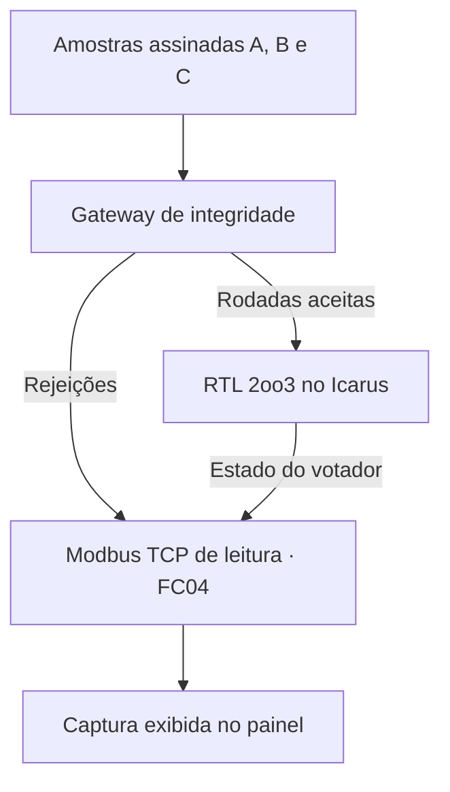

# T3-Guard

**Cibersegurança industrial com verificação local de medições e diagnóstico em FPGA.**

O T3-Guard é um protótipo de bancada para verificar a integridade de medições em sistemas industriais críticos. O gateway autentica amostras de pressão, rejeita mensagens alteradas ou repetidas e expõe o resultado via Modbus TCP. Um votador 2oo3 em SystemVerilog, validado em simulação, sinaliza divergências e registra as transições da saída de disparo.

No ensaio integrado, o gateway envia as rodadas aceitas ao RTL simulado no Icarus. O cliente Modbus lê o diagnóstico produzido pelo RTL junto com os contadores de rejeição. O [painel](docs/index.html) reproduz essa captura. O [vídeo](docs/video-integridade.mp4) mostra os resultados do ensaio integrado, as formas de onda do RTL no Cadence e a preparação da bancada com a DE0-CV.

[Demo online](https://joaovitorclima.github.io/T3-Guard/) · [Pitch narrado](https://joaovitorclima.github.io/T3-Guard/video-pitch.mp4) · [Resultados da demonstração e piloto](DEMONSTRACAO.md) · [Bancada DE0-CV](fpga/README.md) · [Gateway Modbus](gateway/README.md)

O primeiro ensaio usa pressão em um skid. A arquitetura é reaproveitável em linhas de petróleo e gás, estações de água e outras aplicações civis de automação. Temperatura, nível e vazão exigem aquisição compatível, três canais da mesma variável e validação com dados do novo processo. O monitoramento de eventos de trancas eletrônicas e controle de acesso físico é uma linha futura, com sinais e regras próprios.

## Por que monitorar localmente

- **Saneamento municipal.** Em 2023, um incidente cibernético atingiu equipamentos de uma estação de bombeamento da autoridade municipal de água de Aliquippa, na Pensilvânia. É um exemplo de como um incidente digital pode afetar a operação de um serviço essencial. [Registro legislativo da Pensilvânia](https://www.palegis.us/legislation/bills/text/PDF/2025/0/HR0087/PN0717)
- **Controle de acesso digital.** Em 2018, o Facebook relatou o roubo de tokens de acesso a contas. O caso ilustra a importância de proteger credenciais. Em trancas eletrônicas, a aplicação futura seria monitorar eventos de acesso e sinalizar ocorrências para investigação. [Comunicado do Facebook](https://about.fb.com/news/2018/10/update-on-security-issue/amp/)
- **Natanz.** O caso Stuxnet, associado à instalação iraniana de enriquecimento de urânio, mostra que um incidente em sistemas de controle pode ter efeitos físicos. É uma referência histórica para a motivação em infraestrutura crítica. [Audiência do Congresso dos EUA](https://www.govinfo.gov/content/pkg/CHRG-119hhrg62627/html/CHRG-119hhrg62627.htm)

## Arquitetura

### Ensaio integrado

O gateway verifica a autenticação, a sessão e a sequência de cada amostra. Apenas rodadas aceitas chegam ao RTL. Um cliente Modbus real em loopback lê o estado do votador e os contadores de rejeição. O painel reproduz essa captura.



### Lógica do votador

| Modo | Canais válidos | Condição de disparo |
| --- | :---: | --- |
| **Normal** | 3 | Dois ou mais votos altos (2oo3). |
| **Degradado** | 2 | Pelo menos um voto alto (1oo2). |
| **Seguro** | 0 ou 1 | Disparo por falta de canais válidos. |

- **Faixa e histerese.** Na escala sintética de 0 a 1000, o voto sobe em 700 e retorna a zero em 650. Entradas inválidas ou fora da faixa são excluídas.
- **Diagnóstico.** O RTL exclui um canal quando, por três amostras consecutivas, ele fica a mais de 180 unidades de cada um dos outros dois e a diferença entre esses dois é de até 180 unidades.
- **Watchdog e rearme.** A perda de amostragem invalida os três canais. Uma vez acionado, o `trip` fica travado até um pedido de rearme acompanhado de uma amostra com três canais válidos e votos baixos.
- **Eventos.** O RTL guarda o último evento com o ciclo e um contador. O CSV conserva a sequência de eventos observada pelo testbench. Saltos no contador da UART indicam eventos intermediários não recebidos.

### Bancada DE0-CV

O [projeto para a DE0-CV](fpga/README.md) usa chaves para representar os canais. O `trip` acende um LED e a UART exporta o último evento para o gateway. Os ensaios documentados executam o RTL em simulação. A montagem com a placa e o CLP permanece prevista para o piloto.

## Executar

Abra [docs/index.html](docs/index.html) no navegador para percorrer a captura gravada. Para reproduzir os testes em Linux ou WSL, rode no diretório do projeto:

```bash
bash sim/run.sh
diff -u docs/trace.csv build/trace.csv
python3 -m unittest discover -s gateway
python3 -m gateway.demo_integrada
python3 gateway/modbus.py --replay docs/trace.csv
```

Com o Xcelium no PATH, use `bash sim/run.sh xrun`. O testbench passou no Xcelium 24.09-s013 e no Icarus. Ele percorre os oito padrões binários do 2oo3 e checa exclusão por discrepância, invalidação de canais, 1oo2, histerese, watchdog e condições de rearme.

Para gravar as formas de onda no Xcelium, execute `bash sim/run.sh xrun-waves` e copie o comando `simvision -waves -input ...` exibido no final. O script do visualizador carrega `a`, `b`, `c`, `discrep`, `bad`, `mode` e `trip` e ajusta o zoom para o intervalo completo.

### Conferir os arquivos da demonstração

O [manifesto SHA-256](docs/SHA256SUMS) registra os hashes da página, das capturas e dos vídeos. Para comparar os arquivos com o manifesto do commit revisado, rode na raiz do projeto:

```bash
(cd docs && sha256sum --strict --check SHA256SUMS)
```

A verificação também roda no GitHub Actions. Se algum arquivo da demo mudar, atualize o manifesto:

```bash
(cd docs && sha256sum index.html integrity.js integrity-trace.js trace.js trace.csv \
  video-integridade.mp4 video.mp4 video-pitch.mp4 > SHA256SUMS)
```

## Dados, artigo e IA local

O [PRONTO](https://zenodo.org/records/1341583) reúne medições de processo, pressões e alarmes coletados em uma instalação experimental de escoamento multifásico, em condições normais e com falhas induzidas. O artigo de Stief et al., publicado no *Journal of Process Control* em 2019, apresenta a coleta e exemplos de avaliação de métodos de diagnóstico. No T3-Guard, a pressão medida no ponto PT417 alimenta uma reprodução local com três canais derivados e um desvio injetado em B. [Artigo e DOI](https://doi.org/10.1016/j.jprocont.2019.04.009)

A prova de conceito executa o diagnóstico e o ensaio Modbus no próprio notebook, sem depender da internet. O [experimento de classificação](diagnostico/README.md) também treina e testa uma árvore de decisão localmente, com dados sintéticos. A evolução proposta é validar o modelo com ensaios separados e executar a inferência na FPGA. O objetivo é detectar cedo os sinais observáveis de comprometimento, como leituras alteradas ou fora do padrão, e medir quanto tempo o alerta dá para a equipe investigar.

## Integridade de medições em bancada

O gateway valida amostras autenticadas e rejeita repetições em uma sessão de bancada. O [ensaio Modbus](gateway/README.md#verificação-de-integridade-em-bancada) usa produtores simulados e expõe frescor por canal e contadores de rejeição via FC04.

## Validação com uma empresa

Proposta inicial para a equipe de automação ou instrumentação da Acelen, em Mataripe, como hipótese de parceiro de bancada. O piloto usa chaves da FPGA e um notebook em ambiente isolado. Critérios de aceite são reproduzir cinco cenários, comparar os registros com a sequência aplicada e medir o tempo para identificar o primeiro evento. A economia de tempo e a redução de paradas indevidas ainda são hipóteses a medir.

Protótipo didático para bancada. A demonstração usa LED como saída. Sensores, estágio de saída, independência e cobertura diagnóstica, falhas de causa comum, deriva, travamento individual e atendimento de SIL dependem de projeto e validação específicos antes de qualquer aplicação industrial.

O [plano de validação](VALIDACAO.md) reúne fontes técnicas e descreve o experimento comparativo para um artigo.

## Referências

- [Terasic DE0-CV](https://www.terasic.com.tw/cgi-bin/page/archive.pl?No=921)
- [Modbus Application Protocol V1.1b3](https://www.modbus.org/file/secure/modbusprotocolspecification.pdf)
